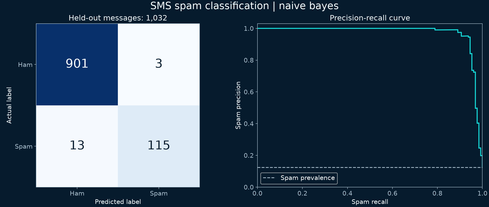

# SMS spam classifier in Python

A new assisted portfolio project built in October 2026. This is separate from the earlier cybersecurity coursework. It runs locally, without MongoDB, X, or OpenAI credentials.

## What it does

Converts message text into TF-IDF features, compares logistic regression with multinomial Naive Bayes, and predicts spam or ham (ordinary messages). Uses the public UCI SMS Spam Collection.

## Checked results

The downloaded archive contains 5,574 message rows. Unicode NFKC, case-folding, and whitespace normalization identify repeated text. 415 repeated rows were removed; 0 conflicting-label rows were excluded. The remaining 5,159 messages were split into 4,127 training and 1,032 test observations, stratified by label (seed 42).

The TF-IDF vocabulary and IDF weights are fitted inside each training fold. Five-fold cross-validation on training data selects hyperparameters and the final model by spam F1. The threshold stays at 0.5. Test outcomes are not used for model selection. The same normalized message never appears in both splits. Similar templates with different wording can still cross splits.

| Model | Accuracy | Spam precision | Spam recall | Spam F1 | False alarms | Missed spam |
| --- | ---: | ---: | ---: | ---: | ---: | ---: |
| Logistic Regression | 98.3% | 100.0% | 85.9% | 0.924 | 0 | 18 |
| Naive Bayes | 98.4% | 97.5% | 89.8% | 0.935 | 3 | 13 |

**Selected using training cross-validation: multinomial Naive Bayes.** On the test split it correctly flagged 115 spam messages and correctly left 901 legitimate messages unflagged. It missed 13 spam messages and flagged 3 legitimate messages.

Always predicting ham yields 87.6% accuracy while finding zero spam. This is why spam precision and recall matter alongside accuracy.



## Run locally

Python 3.12 was used. From this project folder:

```sh
python3 -m venv .venv
source .venv/bin/activate
python -m pip install -r requirements.txt
python train.py
python predict.py "Can we meet at the library at six?"
python predict.py "Congratulations! You won a free prize. Claim your cash reward now."
```

The downloaded dataset and trained model are included, so no data collection or API account is needed. Installing dependencies needs internet access. Training downloads the public archive only if `source.zip` is absent. Prediction stays on your Mac. Only load the included model or one you trained yourself; model files use Python serialization.

The two messages above are invented demo inputs, not evaluation data. They were classified as ham and spam respectively in the local smoke test. Demo outputs do not measure accuracy. Blank inputs are rejected.

## Files to inspect

- `train.py`: source download, normalization, data checks, training, evaluation, and chart.
- `predict.py`: local message scoring.
- `metrics.json`: exact results, selected parameters, source checksum, and versions.
- `test_predictions.csv`: test labels and predictions by source row, without repeating message text.
- `split_membership.csv`: split membership and normalized-message hashes.
- `spam_model.joblib`: selected fitted model.

## Limits

This is an educational benchmark, not a deployed security product. The corpus is historical and not chronologically sorted. A random split is not a future-time test. Near-duplicate spam campaigns may remain after exact normalized deduplication. Results do not establish performance on current phishing, other languages, email, or adversarial messages. The score is not calibrated or a guarantee of safety. A ham prediction does not mean a link or sender is safe. No URLs are opened and no messages are sent by this project. The selected objective does not estimate the real-world cost of blocking a legitimate message.

## Sources and attribution

Almeida, T. & Hidalgo, J. (2011). *SMS Spam Collection*. UCI Machine Learning Repository. [Dataset and CC BY 4.0 license](https://archive.ics.uci.edu/dataset/228/sms+spam+collection). DOI: https://doi.org/10.24432/C5CC84. The original archive, including its readme, is retained in `source.zip`. Credit belongs to the dataset authors and original corpus contributors.

Implementation references: [scikit-learn text feature extraction](https://scikit-learn.org/stable/modules/feature_extraction.html#text-feature-extraction), [avoiding data leakage](https://scikit-learn.org/stable/common_pitfalls.html#data-leakage), and [classification metrics](https://scikit-learn.org/stable/modules/model_evaluation.html#classification-metrics).

The model and scripts were created with coding assistance. No claim is made that James collected the source messages or built this as part of his earlier course submission.
